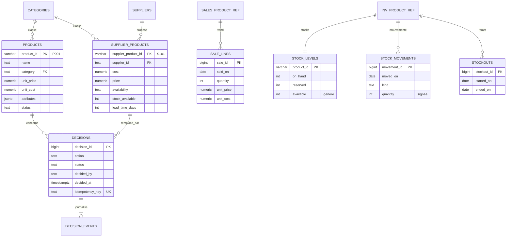

# Modèle de données (LSO-5)

Une base PostgreSQL, **un schéma par service**, aucune clé étrangère entre schémas. Migrations SQL
versionnées dans `services/<service>/migrations/NNN_*.sql`, appliquées par `python -m data.migrate`
(table `public.schema_migrations` avec somme de contrôle : rejouer ne fait rien, une migration
modifiée après application est refusée).

## Propriété des données

| Schéma | Propriétaire | Tables | Domaines Jira |
|---|---|---|---|
| `catalog` | service catalogue | `categories`, `products`, `suppliers`, `supplier_products`, `decisions`, `decision_events` | produits, catalogue fournisseurs, décisions |
| `sales` | service ventes | `product_ref`, `sale_lines` | ventes |
| `inventory` | service stocks | `product_ref`, `stock_levels`, `stock_movements`, `stockouts` | stocks, ruptures |

`sales.product_ref` et `inventory.product_ref` sont des **copies de référence** (id, nom, catégorie)
de `catalog.products`, alimentées par le générateur ; `data.verify` contrôle qu'elles sont identiques.
Inventory calcule la demande à partir de ses propres sorties de stock : aucun appel entre services.

## Contraintes d'intégrité (toutes testées dans `tests/data/test_migrations.py`)

| Règle | Mise en œuvre |
|---|---|
| Identifiants compatibles avec l'orchestrateur | `CHECK (product_id ~ '^P[0-9]{3,5}$')`, idem `S…`, `F…` |
| Montants et quantités non négatifs | `CHECK (… >= 0)` ; vente : `quantity > 0` |
| Réservé ≤ physique ; disponible = physique − réservé | `CHECK (reserved <= on_hand)` ; colonne générée `available` |
| Sens des mouvements | `sale` < 0 ; `initial`, `receipt`, `return` > 0 ; jamais 0 |
| Une seule rupture en cours par produit | index unique partiel `WHERE ended_on IS NULL` |
| Fin de rupture ≥ début | `CHECK (ended_on >= started_on)` |
| Disponibilité fournisseur cohérente | `out_of_stock` ⇔ `stock_available = 0` ; délai 1–365 j |
| Remplaçant obligatoire ssi `replace` ; remplaçant existant | `CHECK` + clé étrangère vers `supplier_products` |
| Décision tranchée ⇒ auteur et date | `CHECK` sur `status`, `decided_by`, `decided_at` |
| Pas de double décision rejouée | `UNIQUE (recorded_by_client, idempotency_key)` + `request_hash` (migration 002) |
| Identité authentifiée tracée | `decisions.recorded_by_client`, `decision_events.client` (migration 002) |
| Écritures non authentifiées distinguées | `source = 'legacy'` (migration 003) + index de déduplication |
| Journal d'audit en ajout seul | déclencheur qui refuse `UPDATE` et `DELETE` sur `decision_events` |

## Champs exposés aux autres parties

| Consommateur | Champs garantis |
|---|---|
| Orchestrateur (PR #1) | ceux de `docs/api.md` : `product_id`, `name`, `category`, `units_sold`, `revenue`, `margin_rate`, `trend_6m`, `quantity`, `coverage_days`, `supplier_product_id`, `price`, `decision_id`, `status` |
| Analysis (Partie 1) | `trend_6m`, `margin_rate`, `gross_margin`, `revenue_change`, `coverage_days`, `coverage_status`, `avg_daily_demand` ; candidats : `category`, `price`, `cost`, `availability`, `lead_time_days` (via REST, D-2) |

## Jeu de données (LSO-6)

`python -m data.generate --seed 42 --reference-date 2026-10-31` : 60 produits (10 catégories,
P001–P006 identiques aux mocks), 18 mois de ventes quotidiennes avec saisonnalité (rentrée, Black
Friday, fêtes), 200 références fournisseurs S101–S300 (8 fournisseurs fictifs), stock simulé jour par
jour avec réassort, 2 décisions de démonstration auditées.

Scénarios imposés : P001 croissance ; P003, P005, P042 baisse + surstock ; P006, P050 baisse +
rupture en cours ; P013 plus aucune vente depuis 75 jours ; P020, P031 rupture passée (retard
fournisseur). `python -m data.verify` exécute 10 contrôles et affiche l'empreinte de reproductibilité.
